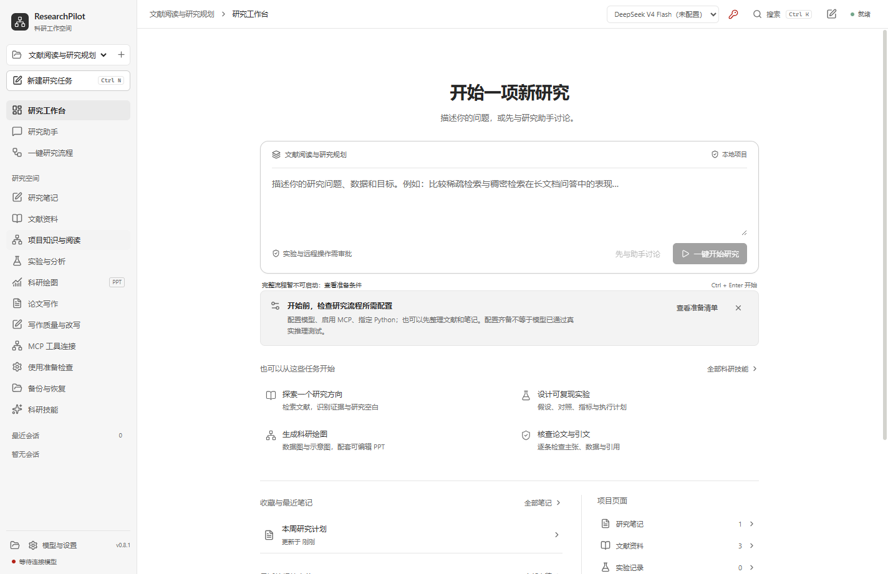
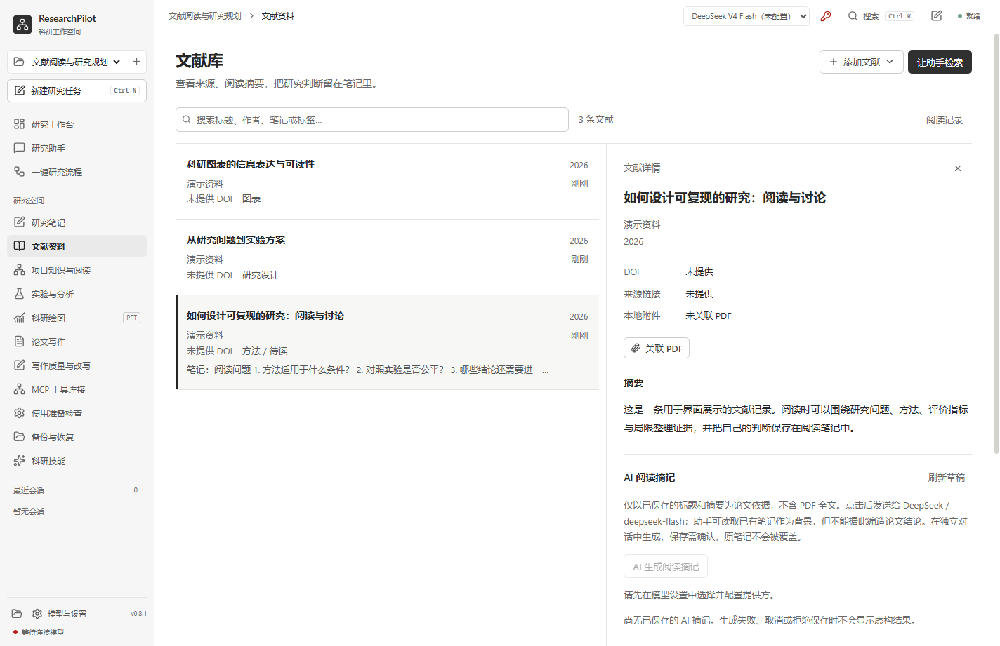
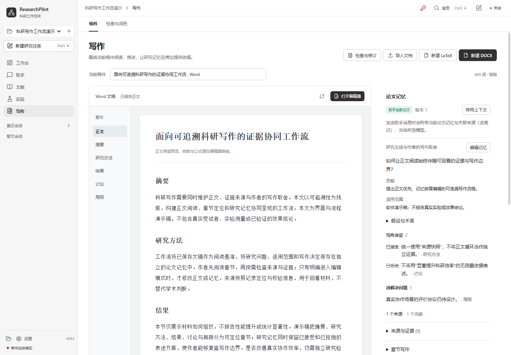
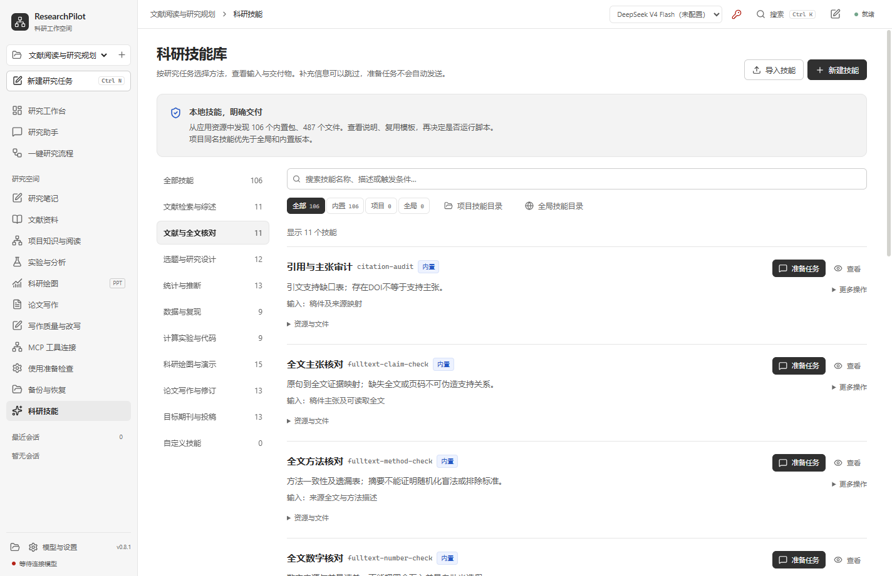
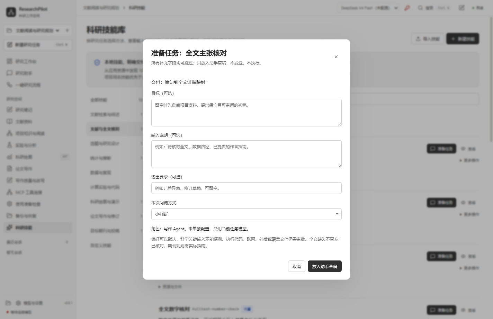

# ResearchPilot

把文献、实验、图表和论文放进同一个研究项目。

ResearchPilot 是一款面向科研工作的 AI 桌面工作台。你可以用它整理和阅读文献、记录想法、运行实验、制作科研图表，再把结果组织成论文。写作、绘图和工程任务可以分别使用不同的模型服务。

[下载桌面版](https://github.com/lafin-123/ResearchPilot/releases/latest) · [安装与配置](docs/DEPLOYMENT.md) · [GitHub 仓库](https://github.com/lafin-123/ResearchPilot)



*研究工作台。以下界面截图使用演示项目。*

## 能用它做什么？

### 整理文献，带着问题阅读

通过关键词和 DOI 查找文献，导入 BibTeX，关联本地 PDF。在阅读器中高亮、批注，把摘录转成研究笔记。需要核对原文时，可以按页提取 PDF 文字，保留页码与来源定位。

AI 阅读摘记适合快速梳理论文摘要；全文核对技能则帮助你逐项检查主张、数字、方法和图表。



### 从研究问题走到实验结果

围绕问题制定假设、对照方法和实验方案，在本机 Python 环境中运行代码，集中查看指标、日志与产物。也可以配置 SSH 主机处理远程实验。

想按完整流程推进时，可以从工作台启动：

**文献调研 → 假设与方案 → 实验设计 → 执行 → 分析 → 绘图 → 写作 → 审阅**

各阶段保留产物和交接记录，便于检查进展、定位问题和继续任务。

### 让图表进入论文，也能继续编辑

制作柱状图、折线图、散点图和方法流程图，保存结构化源文件，导出 SVG 与 PowerPoint。数据图使用原生图表和内嵌工作簿，方法图由独立形状、文字和连线组成。

更灵活的绘图需求可以使用 Python。稿件支持 DOCX 与 LaTeX，配合章节写作、图注、引用核对和目标期刊修改技能使用。

### 让论文保持自己的研究上下文

在 **写作 → 稿件** 选择当前稿件，主区域阅读正文并按章节跳转；右侧“论文记忆”默认显示研究主线、写作决定与待处理问题，具体字段按需编辑。关联项目文献、笔记、实验运行和图表后，可预览将提供给助手的证据片段。



*中文演示稿，仅展示软件工作流，不包含真实研究结论。*

设为当前论文后，助手在发送前自动读取最新记忆和匹配来源；来源变化或缺失会排除旧快照并提示复核，不把论文自己的陈述当成独立证据。准备章节只生成可编辑请求，不自动发给模型，也不覆盖正文。第一版采用本地词项/章节匹配，PDF仅采集有界文字层，不宣称向量检索、OCR或全自动事实核验。见 [使用与边界](docs/paper-context.md)。

### 让论文表达更具体

在 **写作质量与来源对照 → 学术表达去套路** 中，先检查原文，再查看修改建议，确认后生成独立修订稿。原文保留不动；数字、引用、指定术语、代码与公式等内容有额外保护。修改记录可导出，修订稿可另存为 DOCX。

内置 [shiujan 的 lieflat-less-ai-tone](https://github.com/larashero3-dotcom/lieflat-less-ai-tone)，附科研写作适配，不必另装技能包。模型审阅使用写作角色配置，发送前会提示；本地脚本需要 Python 3.10+，也能离线查找 uv 已安装的解释器。短文、英文或缺少解释器时会说明未执行统计检测，不伪造结果。

智能体写作和论文流水线也会默认加载这份技能与学术适配。原生面板提供局部修改审阅，不冒充上游完整逐候选语义标注；科学含义仍由作者核对。技能及其适配保留 CC BY-NC 4.0，见 [第三方声明](THIRD_PARTY_NOTICES.md)。

### 把研究想法和证据连接起来

用 Markdown 研究笔记记录问题、阅读心得和实验观察，支持搜索、收藏、页面链接、反向链接与回收站。项目知识库可以检索文献标题、摘要和阅读笔记，为助手提供相关上下文。

项目资料保存在本机，可通过备份功能导出，再恢复为独立项目。

## 107 项科研技能，按任务选用

技能库提供分类导航、中英文搜索、输入说明和交付模板。你既可以选一个技能处理眼前的任务，也可以让它们配合完整研究流程。

| 任务方向 | 示例 |
| --- | --- |
| 文献检索与综述 | 检索式设计、文献筛选、系统综述、引文追踪、研究缺口 |
| 文献与全文核对 | 元数据、主张支持、数字、方法、图表、直接引语 |
| 设计与统计 | 预注册、样本量、问卷、质性分析、因果推断、敏感性分析 |
| 数据与计算实验 | 数据审计、泄漏排查、复现计划、模型评估、消融、代码审阅 |
| 绘图与演示 | 图形选型、配色、误差表达、森林图方案、图注、海报 |
| 写作与投稿 | 各章节写作、学位论文提纲、期刊指南、格式修改、投稿信、返修回复 |



还可以创建自己的技能，或导入已有的 `SKILL.md` 技能包。

## 三种角色，各用合适的模型

在设置中分别选择 **写作 Agent、绘图 Agent、工程与实验 Agent** 的提供方和模型。每个提供方都可以使用自己的 API 地址和 Key。

角色使用独立会话，按研究阶段交接，共享项目产物。没有单独配置的角色沿用任务中明确选定的模型；研究探索和原生润色会显示角色或全局默认模型的实际配置。

聊天输入框旁可直接选择 **本轮模型**。一轮回复结束后可以切换供应商或模型，在同一会话中继续，历史消息和会话上下文保留；选择会保存到当前会话，重启后仍有效。生成或提交期间暂时锁定切换。新会话的首选模型在 **设置 → 全局默认模型** 中明确选择，不按上游列表的第一项决定。

你也可以选择助手的问询方式：

- **少打断**：采用合理的偏好默认值，先给出可审阅的草稿。
- **关键处询问**：只对影响研究设计或结果的问题进一步确认。
- **先问清楚**：开始前集中梳理任务输入。

准备技能任务时，补充字段可以留空；先放入助手草稿，检查后再发送。



## 五分钟开始

1. 安装桌面版：Windows x64 使用 `.exe` 安装向导，Linux x64 使用 `.deb`（Debian/Ubuntu）或 `.tar.gz` 解压版。
2. 打开应用，进入本地工作区，无需注册应用账户。
3. 在底部 **设置 → 模型与偏好** 添加提供方，填写 API 地址和 Key，点击 **获取上游模型**，勾选后保存。
4. 创建研究项目，加入文献或写下研究问题。
5. 从 **助手 → 技能库** 选择任务，或在工作台与助手讨论。

左侧只保留 **工作台、助手、文献、实验、写作** 五个主入口，具体工具在页面顶部切换。工具连接、环境检查和备份位于底部 **设置** 中；也可以用 `Ctrl K` 搜索工具名称直接跳转。

运行实验时，再到运行环境中选择 Python 3.10+；启动完整流程前，可用 **设置 → 环境检查** 一次核对配置。详细步骤见 [安装与配置教程](docs/DEPLOYMENT.md)。

## 从源码运行

需要 Windows 或 Linux 桌面环境和 Node.js 24+。在项目根目录执行：

```bash
npm ci
```

```bash
npm run dev
```

开发验证：

```bash
npm run typecheck
```

```bash
npm test
```

Windows 安装包构建：

```bash
npm run package:win
```

Linux x64 安装包与解压版构建：

```bash
npm run package:linux
```

更多运行、打包和排错方法见 [部署教程](docs/DEPLOYMENT.md)。

## 使用前了解这几件事

研究资料主要保存在本机；发送给助手的内容会由你选择的模型服务处理，调用费用按服务商规则计算。执行代码、外部请求和文件修改时，应用会按操作请求确认。

PDF 文字提取适用于有文字层的页面，扫描件需要 OCR 或视觉阅读。技能提供方法与工作流程，具体计算使用你配置的运行环境。完整的工具范围和数据说明放在 [技术说明](docs/TECHNICAL_NOTES.md)。

## 文档

- [安装、模型配置与源码部署](docs/DEPLOYMENT.md)
- [技术说明与数据管理](docs/TECHNICAL_NOTES.md)
- [技能、全文工具与角色协作实现记录](docs/skills-and-model-discovery.md)
- [完整科研流程验证记录](docs/full-research-validation.md)

## 许可证

项目自有代码采用 [PolyForm Noncommercial 1.0.0](LICENSE.md)，供许可证允许的非商业用途使用、修改和分发。商业使用请联系仓库维护者取得授权。第三方组件遵循各自许可证，详见 [NOTICE](NOTICE.md) 和 [第三方声明](THIRD_PARTY_NOTICES.md)。
